

<picture><source media="(prefers-color-scheme: dark)" srcset="assets/hero-dark.svg"></picture>

<picture><source media="(prefers-color-scheme: dark)" srcset="assets/social-l-dark.svg"></picture><a href="https://discord.gg/pqUvvuxkEB"><picture><source media="(prefers-color-scheme: dark)" srcset="assets/social-1-dark.svg"></picture></a><a href="https://tiktok.com/@madebyanto.sh"><picture><source media="(prefers-color-scheme: dark)" srcset="assets/social-2-dark.svg"></picture></a><a href="madebyanto-support.stretch647@passinbox.com"><picture><source media="(prefers-color-scheme: dark)" srcset="assets/social-3-dark.svg"></picture></a><a href="https://youtube.com/madebyanto"><picture><source media="(prefers-color-scheme: dark)" srcset="assets/social-4-dark.svg"></picture></a><picture><source media="(prefers-color-scheme: dark)" srcset="assets/social-r-dark.svg"></picture>

<picture><source media="(prefers-color-scheme: dark)" srcset="assets/about-dark.svg"></picture>

<picture><source media="(prefers-color-scheme: dark)" srcset="assets/stack-dark.svg"></picture>

<a href="https://github.com/madebyanto/rinux"><picture><source media="(prefers-color-scheme: dark)" srcset="assets/project-rinux-dark.svg"></picture></a>&nbsp;<a href="https://github.com/madebyanto/eos-to-arch"><picture><source media="(prefers-color-scheme: dark)" srcset="assets/project-eos-to-arch-dark.svg"></picture></a>

<a href="https://github.com/madebyanto/sharemiishot"><picture><source media="(prefers-color-scheme: dark)" srcset="assets/project-sharemiishot-dark.svg"></picture></a>&nbsp;<a href="https://github.com/madebyanto/madebyanto"><picture><source media="(prefers-color-scheme: dark)" srcset="assets/project-madebyanto-dark.svg"></picture></a>

<picture><source media="(prefers-color-scheme: dark)" srcset="assets/stats-dark.svg"></picture>

<picture><source media="(prefers-color-scheme: dark)" srcset="assets/streak-dark.svg"></picture>

<picture><source media="(prefers-color-scheme: dark)" srcset="assets/wave-dark.svg"></picture>

<a href="https://github.com/madebyanto?tab=repositories"><picture><source media="(prefers-color-scheme: dark)" srcset="assets/button-1-dark.svg"></picture></a>&nbsp;&nbsp;<a href="madebyanto-support.stretch647@passinbox.com"><picture><source media="(prefers-color-scheme: dark)" srcset="assets/button-2-dark.svg"></picture></a>&nbsp;&nbsp;<a href="https://guns.lol/madebyanto"><picture><source media="(prefers-color-scheme: dark)" srcset="assets/button-3-dark.svg"></picture></a>

<a href="https://metawka.github.io/expressive-profile/?from=madebyanto"><picture><source media="(prefers-color-scheme: dark)" srcset="assets/credit-dark.svg"></picture></a>

